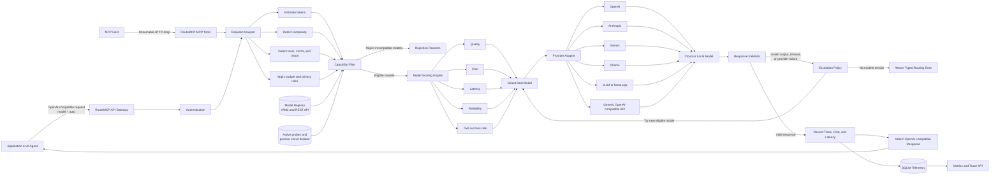
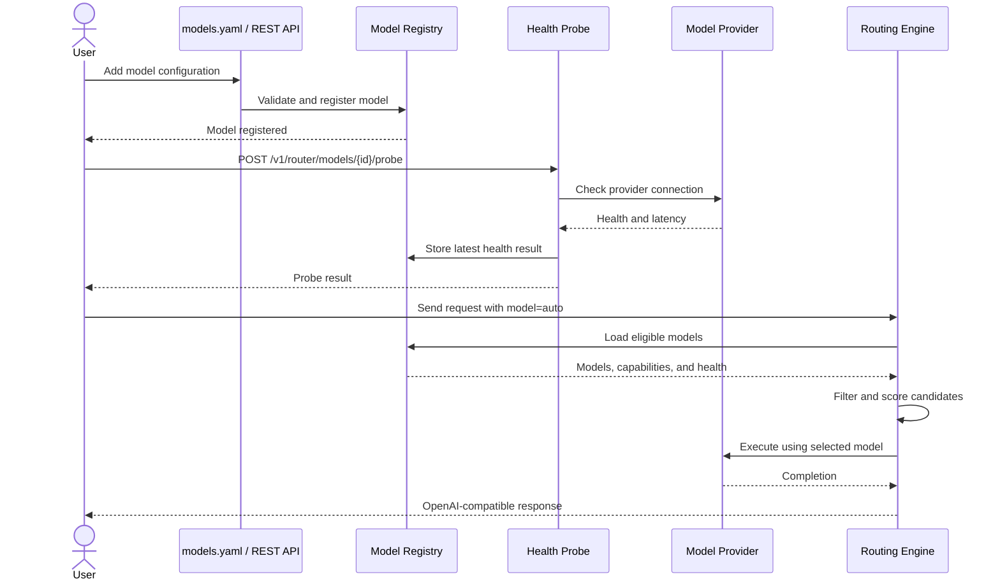

# RouteMCP

RouteMCP is a small, self-hosted gateway that routes OpenAI-compatible chat
requests across model providers. For each request it filters models by hard
requirements (tools, JSON, vision, context, budget, latency, privacy), ranks the
rest using **measured** evidence, fails over to the next eligible model after
provider or validation failures, and records every decision in SQLite.

Routing improves with use:

- **Operational signals are learned online.** Latency, success rate, and
  tool-call success are tracked per model as moving averages from live traffic
  and blended with the configured priors.
- **Cheap models answer when they are confident.** With `cascade` enabled, the
  gateway first asks cheaper models and keeps an answer whose token
  log-probabilities clear a threshold, escalating to the routed model otherwise.
- **Quality is calibrated from ground truth.** `routemcp evaluate` runs your
  models on tasks with deterministic validators; `routemcp calibrate` loads the
  measured pass rate for each model and task type into the gateway. Routing then
  sends each task type to the cheapest model that is within the profile's quality
  tolerance of the best one.

RouteMCP also exposes the router as an authenticated Model Context Protocol
server, so MCP hosts can inspect decisions, run routed completions, and list
models with their learned statistics.

On a 260-task evaluation with gpt-4.1, gpt-4.1-mini, and gpt-4.1-nano, the
`quality` profile with the confidence cascade matched or beat always using
gpt-4.1 at 77–88% lower cost, and came within 1–2 tasks of always using
gpt-4.1-mini, the best single model there, at up to 41% lower cost. It did not
beat mini's accuracy. See [Results](#results-gpt-41-gpt-41-mini-gpt-41-nano).

## How it compares

| | Learned routing signal | Self-hosted | Hard per-request constraints | Decision transparency | MCP server |
| --- | --- | --- | --- | --- | --- |
| LiteLLM proxy | Load, latency, cost, usage strategies | Yes | Deployment-level | Basic | Proxies models |
| OpenRouter | Hosted auto-router | No | Provider filters | Limited | No |
| RouteLLM | Per-prompt strong/weak router trained on preference data | Yes (library) | No | Threshold only | No |
| Not Diamond, Martian | Proprietary per-prompt routers | No | Varies | Limited | No |
| RouteMCP | Per-model, per-task-type pass rates from your own validated tasks, plus live latency and reliability | Yes | Yes, with rejection reasons | Every score component and its evidence | Yes |

Choose LiteLLM for broad provider coverage, centralized keys, and spend
controls. Choose RouteLLM or a commercial router when you want a fine-grained
per-prompt learned router. RouteMCP targets the gap between them: a transparent,
self-hosted router that learns from your own tasks and enforces hard constraints.
Its quality model is per task type, which is coarser than a per-prompt router;
the confidence cascade recovers part of the per-request signal by letting a
cheap model keep the answers it is sure of. The evaluation below measures both.

## Quick start

RouteMCP requires Python 3.9 or newer.

```bash
python -m venv .venv
source .venv/bin/activate
pip install -e '.[dev]'
cp models.example.yaml models.yaml
routemcp serve --config models.yaml
```

Validate configuration without starting the server with
`routemcp check-config --config models.yaml`.

The example configuration uses mock models and works without API keys. Check the
server and make a routed request:

```bash
curl http://127.0.0.1:8000/healthz

curl http://127.0.0.1:8000/v1/chat/completions \
  -H 'Content-Type: application/json' \
  -d '{
    "model": "auto",
    "messages": [{"role": "user", "content": "Explain consistent hashing"}],
    "route": {"profile": "balanced"}
  }'
```

The response is OpenAI-compatible and includes a `_routemcp` object with the
trace ID, selected configured model, attempt count, and cost estimate.

## Architecture



### Model registration flow



## Configuration

Models are loaded from YAML at startup. Each entry has a RouteMCP `id` and the
provider's own `model` name. Remote providers should reference an environment
variable rather than placing a secret in YAML.

```yaml
models:
  - id: openai-fast
    provider: openai
    model: gpt-4.1-mini
    api_key_env: OPENAI_API_KEY
    cost:
      input_per_million: 0.40
      output_per_million: 1.60
    capabilities:
      tools: true
      json: true
      vision: true
      context_window: 1048576
      max_output_tokens: 32768
```

Supported provider kinds are `openai`, `anthropic`, `gemini`, `ollama`,
`openai-compatible`, and `mock`. Ollama and generic OpenAI-compatible entries
require `base_url`. Native cloud entries require `api_key_env`.

Routing profiles are `cheapest`, `fastest`, `balanced`, and `quality`. Each
profile weights quality, cost, latency, and reliability, and also sets a quality
tolerance: the largest expected-accuracy gap versus the best eligible model it
accepts for a cheaper or faster model (0.30 for `cheapest` and `fastest`, 0.10 for
`balanced`, 0.03 for `quality`). Models outside the tolerance stay eligible as
fallbacks. Per-request options can set cost and latency ceilings, require
local-only execution, override task metadata, change the tolerance, and cap retry
attempts:

```json
{
  "profile": "quality",
  "max_cost_usd": 0.05,
  "max_latency_ms": 5000,
  "max_quality_gap": 0.05,
  "privacy": "standard",
  "max_attempts": 3,
  "cascade": false,
  "cascade_min_logprob": -0.01
}
```

### Confidence cascade

Set `"cascade": true` to try cheaper models before the routed choice. The
ladder is every eligible model cheaper than the routed model that declares
`capabilities.logprobs: true`, cheapest first. Each rung is called with
`logprobs` enabled; an answer is kept when its least likely token has
log-probability at or above `cascade_min_logprob` (default −0.01). A tool call
counts as confident when its arguments parse as JSON, because providers do not
return log-probabilities for tool calls. Otherwise the router escalates to the
next rung and finally to the routed model, called exactly as the client asked.
If every stronger model fails, the gateway returns the last low-confidence
answer instead of an error.

The response's `_routemcp.cascade` lists each rung with its confidence and
whether it was accepted, and `actual_cost_usd` and the trace include every call
made. Log-probabilities are removed from the response unless the client asked
for them. The cascade applies only to non-streaming requests with
`model: "auto"`, and only OpenAI and OpenAI-compatible servers that return
`logprobs` (for example vLLM) can be rungs. Escalations make two or more
sequential calls, so they add latency.

### Learned statistics

The YAML `reliability` block is a prior. Every attempt updates the model's
exponentially weighted latency, success rate, and tool-call success, and
calibration stores measured pass rates per task type. Scoring blends live
signals with the prior using `ROUTEMCP_PRIOR_STRENGTH` pseudo-observations
(default 10), so a handful of samples nudges the prior and hundreds replace it.
Calibrated quality uses a weaker prior (`ROUTEMCP_QUALITY_PRIOR_STRENGTH`,
default 5), because configured quality is a guess and measured pass rates should
win quickly; the prior still separates models that tie on a small calibration
set. Each candidate in a decision reports the effective values it was scored on
and their source.

| Variable | Default | Effect |
| --- | --- | --- |
| `ROUTEMCP_LEARNING` | `true` | Set `false` to route on YAML priors only |
| `ROUTEMCP_PRIOR_STRENGTH` | `10` | Pseudo-observations given to the YAML latency and success priors |
| `ROUTEMCP_QUALITY_PRIOR_STRENGTH` | `5` | Pseudo-trials given to the YAML quality prior once calibrated |
| `ROUTEMCP_EWMA_ALPHA` | `0.1` | Weight of each new live observation |

Learned statistics are stored in the same SQLite database as the registry and
traces, so they survive restarts. Deleting a model resets them.

## API

- `POST /v1/chat/completions` — route and execute a chat request
- `POST /v1/router/decide` — inspect a decision without calling a model
- `POST /v1/router/workflows` — route and execute an ordered set of agent steps
- `GET /v1/router/models` — list configured models
- `POST /v1/router/models` — register and persist a model
- `PUT /v1/router/models/{id}` — replace a registered model
- `DELETE /v1/router/models/{id}` — remove a registered model
- `POST /v1/router/models/{id}/probe` — probe provider connectivity
- `GET /v1/router/metrics` — aggregate request metrics
- `GET /v1/router/traces/{id}` — inspect a routing trace
- `GET /healthz` — liveness and model count

Set `ROUTEMCP_API_KEY` to require `Authorization: Bearer ...` on `/v1` routes.
Set `ROUTEMCP_DB` to choose the SQLite path. Request prompts are not stored by
default; set `ROUTEMCP_STORE_PROMPTS=true` to retain them in traces.

A model's latest explicit probe result and learned statistics are included in the
model list. Provider failures are also tracked passively; repeated failures or a
failed probe open a circuit for the cooldown, after which the model is retried
half-open, and a successful call closes it. API model changes are persisted in the SQLite
database and survive restarts.

Metrics include request cost, success and escalation rates, model distribution,
latency, and `upper_bound_cost_avoidance_usd`. The latter compares cost with the
most expensive eligible model and is explicitly a diagnostic upper bound—not a
quality-adjusted savings claim. Use the evaluation report for defensible savings.

`stream: true` uses OpenAI-compatible SSE passthrough for OpenAI, Gemini, Ollama,
vLLM, llama.cpp, and generic OpenAI-compatible endpoints. RouteMCP can fail over
when an upstream rejects the request before streaming begins. Native Anthropic
streams are translated into the same OpenAI-compatible chunks, including
incremental tool-call arguments. Once response bytes have reached the caller, a
mid-stream failure cannot safely switch models; it is recorded and contributes to
the circuit breaker.

## MCP server

The MCP server requires Python 3.11 or newer and the optional dependency:

```bash
pip install -e '.[mcp]'
routemcp mcp --config models.yaml --host 127.0.0.1 --port 8001
```

Connect an MCP client to `http://127.0.0.1:8001/mcp`. It exposes:

- `route_decide` — inspect the selected model, candidate scores, and rejections
- `route_complete` — execute a routed completion with validation, fallback, and
  the optional cascade
- `list_routed_models` — inspect registered capabilities, prices, health, and
  learned statistics

The MCP server uses the current Streamable HTTP transport, not the superseded
standalone SSE transport. Set `ROUTEMCP_MCP_API_KEY` (or `ROUTEMCP_API_KEY`) to
require `Authorization: Bearer ...` on every MCP request. The bundled Compose
profile also binds MCP to localhost; use TLS in front of it before exposing it on
a public network.

With Docker Compose, start both interfaces with:

```bash
docker compose --profile mcp up --build -d
```

## Routing evaluation

`evaluation/tasks.jsonl` holds 260 tasks across classification, extraction,
transformation, math, reasoning, code-output prediction, and tool calling, with
easy and hard variants of each. `evaluation/build_dataset.py` generates it from a
seed, and every expected answer is computed rather than hand-labelled: math is
evaluated exactly and code outputs come from running the snippet. Validators are
deterministic (`exact`, `normalized`, `contains`, `regex`, `number`, `choice`,
`json_fields`, `json_match`, `tool_call`).

```bash
routemcp evaluate \
  --config evaluation/openai.yaml \
  --dataset evaluation/tasks.jsonl \
  --strongest-model gpt-4.1 \
  --cheapest-model gpt-4.1-nano \
  --calibration-fraction 0.5 \
  --profiles balanced,quality,cheapest \
  --seed 0 \
  --output evaluation-report.json
```

The run splits tasks 50/50 per task type. Every model answers the calibration
half, and those pass rates become the router's quality evidence. On the held-out
half, each model runs as a fixed baseline and RouteMCP runs once per profile. The
report includes success rate, cost, cost per success, latency, quality retained
and cost saved versus the strongest model, per-task-type results, which model the
router chose for each task type, and an oracle (the cheapest model that passed
each task) as an upper bound. Load the results into a running gateway with
`routemcp calibrate --report evaluation-report.json --db routemcp.db`.

`evaluation/run_openai_eval.sh` runs the published configuration, reading
`OPENAI_API_KEY` from the environment or a gitignored `.env`, and prints the
tables with `evaluation/summarize.py`. Set `EVAL_SEED` to choose the split.

`routemcp replay --report <report.json> --config <models.yaml>` re-routes a
finished run offline with the current scoring code: calibration comes from the
report's calibration rows, and each routed choice is scored with the recorded
result of that model on that task. Requests are sent at temperature 0, so this
measures a scoring change without new API calls. On the first runs of this
evaluation, replaying the unchanged router reproduced every `quality` and
`cheapest` choice and 124 of 130 `balanced` choices (the rest differ because live
runs also learn latency). Replay skips `+cascade` policies, which need live
log-probabilities.

### Results: gpt-4.1, gpt-4.1-mini, gpt-4.1-nano

Two splits of the 260-task dataset (seeds 0 and 1), 130 calibration and 130
held-out tasks each, list prices from October 2026. Together the two runs made
about 3,050 API calls and cost $0.19. Reports, including every model's answer,
are in `evaluation/results/`.

| Held-out policy | Success, seed 0 | Success, seed 1 | Cost, seed 0 | Cost, seed 1 |
| --- | ---: | ---: | ---: | ---: |
| Always gpt-4.1 | 76.1% | 79.2% | $0.0290 | $0.0296 |
| Always gpt-4.1-mini | 80.0% | 80.0% | $0.0059 | $0.0059 |
| Always gpt-4.1-nano | 70.8% | 69.2% | $0.0015 | $0.0019 |
| `quality` | 78.5% | 79.2% | $0.0110 | $0.0059 |
| `quality` + cascade | 78.5% | 79.2% | $0.0068 | $0.0035 |
| `balanced` | 79.2% | 75.4% | $0.0026 | $0.0026 |
| `balanced` + cascade | 78.5% | 76.9% | $0.0026 | $0.0029 |
| `cheapest` | 73.1% | 68.5% | $0.0017 | $0.0018 |
| Oracle (cheapest passing model per task) | 82.3% | 87.7% | $0.0020 | $0.0029 |

What this shows:

- Against always using gpt-4.1, `quality` with the cascade matches or beats it
  at 77–88% lower cost.
- Against always using gpt-4.1-mini, the best single model here, `quality` with
  the cascade is within 1–2 tasks (0.8–1.5 points, inside run-to-run noise) at
  41% lower cost when routing picks mini as the target (seed 1). On seed 0,
  calibration sent math and transformation to gpt-4.1, so escalations went to
  the more expensive model and the cascade cost 15% more than mini. The
  cascade cuts cost at roughly mini's accuracy; it does not raise accuracy above
  mini.
- The cascade kept a cheaper model's answer on 58% of `quality` requests. In a separate
  run of all 260 tasks with log-probabilities, nano was right on every one of
  the 126 answers whose least likely token had log-probability of at least
  −0.01, the default threshold, which was chosen on the calibration halves
  (`evaluation/collect_logprobs.py`, data in
  `evaluation/results/openai-logprobs.json`).
- `balanced` already routes most traffic to nano, so the cascade changes little
  there.
- The cascade adds latency when it escalates: two sequential calls instead of
  one, adding about 140–200 ms to average latency in these runs.
- gpt-4.1 is not better than mini on this dataset because the prompts ask for
  the final answer only, with no room to show work.
- The oracle is still 2–8 points above every policy. Results move by a few
  points between splits (one point is 1.3 tasks), so differences under about
  3 points are noise.

Tuning that the replay and these runs informed:

- **Weaker quality prior.** With 10 pseudo-trials, configured priors outweighed
  20/20 calibration results, so `quality` kept paying for gpt-4.1 on
  classification, extraction, and tool calling, where every model scored 100%.
  At 5, the same accuracy cost 59–76% less.
- **Dropped: a pessimistic quality bound** for cheaper models bought under a
  point of accuracy at 2–4× the cost.
- **Dropped: prompt length as a difficulty signal** did not help.
- **Dropped: agreement between nano and mini as the cascade check.** Agreement
  was 96% accurate, but always paying for both models cost more than mini alone,
  and escalating disagreements to gpt-4.1 did not beat mini.

Two caveats apply. The dataset and the analyzer's task-type rules were written by
the same author, so the report includes `analyzer_task_type_agreement` to show how
the analyzer labelled each task. And the split holds out task instances, not task
types, so it measures routing on familiar kinds of work.

## Gateway benchmark

Measure the same upstream model directly and through RouteMCP:

```bash
python benchmarks/benchmark_gateway.py \
  --gateway-url http://127.0.0.1:8000/v1/chat/completions \
  --direct-url https://provider.example/v1/chat/completions \
  --gateway-model configured-model-id \
  --direct-model provider-model-id \
  --requests 200 \
  --concurrency 20 \
  --output benchmark-report.json
```

The report includes errors, throughput, p50/p95/p99 latency, and added gateway
latency. Run it near both endpoints and repeat runs before publishing numbers.

The checked-in synthetic localhost smoke run used five alternating rounds of 200
requests at concurrency 20. It recorded zero errors, median throughput of 382.03
requests/second through RouteMCP versus 389.84 direct, and mean added latency of
0.75 ms. Its p50 added latency was 6.75 ms; tail deltas were too noisy to report.
See `benchmarks/results/local-synthetic.json`. This validates the benchmark and
gateway path only—it is not a real-model performance claim or resume result.

### Container end-to-end result

The production image was also exercised through its public HTTP and MCP
interfaces. The local deterministic run completed 1,100 load-test requests with
zero errors. At concurrency 25 it measured 650.48 completion requests/second,
338.34 routing decisions/second, and 357.0 streaming requests/second. Completion
latency was 25.56 ms p50 and 91.03 ms p95.

The same run verified model registration across complete container replacement,
a two-step workflow, stream termination, health probing, three successful typed
failovers, and circuit opening after the third provider failure. Median local
failover latency was 1.50 ms; the first request after the circuit opened took
1.46 ms and skipped the failed provider. A real Streamable HTTP MCP client
negotiated protocol `2026-07-28`, discovered all three tools, and successfully
called `route_decide`.

Full machine-readable results and limitations are in
`benchmarks/results/e2e-container.json`. These are gateway correctness and local
performance numbers—not model-quality evidence.

Reproduce the run with Docker Compose and a Python 3.11+ environment that has
`pip install -e '.[mcp]'`:

```bash
benchmarks/run_e2e.sh e2e-results
```

The script generates random API keys for both interfaces unless
`ROUTEMCP_API_KEY` and `ROUTEMCP_MCP_API_KEY` are set. It builds the image,
starts the gateway and MCP containers on a fresh
volume, runs `benchmarks/e2e_gateway.py` (load, workflow, streaming, failover,
circuit breaker, MCP tool calls, and rejection of unauthenticated MCP requests),
replaces both containers, verifies that the
API-registered model survived, and tears everything down. It exits non-zero if
any check fails. Set `PYTHON`, `E2E_REQUESTS`, or `E2E_CONCURRENCY` to override
defaults. Ports 8000 and 8001 must be free.

## Production status

The current release is appropriate for a single-node gateway: durable model
registration, SQLite WAL, API authentication, passive circuit breaking, typed
fallback, streaming passthrough, health probes, Docker, and CI are included.
Learned statistics are per node. Horizontal multi-instance deployment still
requires PostgreSQL or another shared registry, telemetry, and statistics store. Distributed circuit state, rate
limiting, and automated scheduled probes remain explicit production gaps.

## Development

```bash
pip install -e '.[dev,mcp]'
pytest
ruff check .
```

The MCP tests are skipped on Python versions older than 3.11.

Regenerate the evaluation dataset with `python evaluation/build_dataset.py`. It
is seeded, and a test checks that the committed `evaluation/tasks.jsonl` matches
the generator and that every expected answer passes its own validator.
