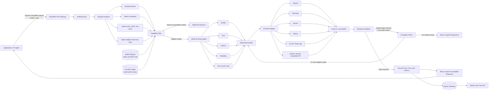
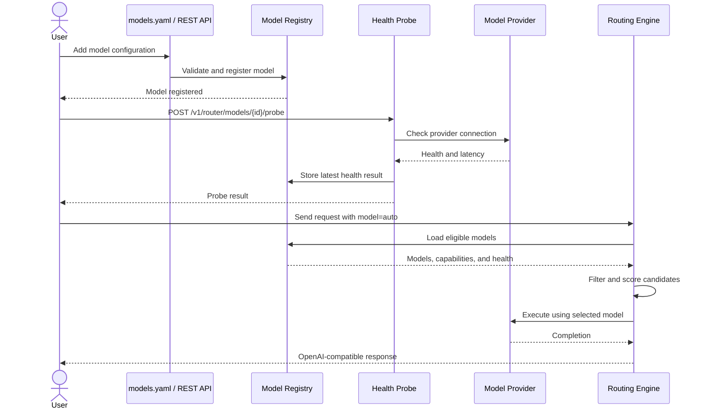

# RouteMCP

RouteMCP is a small, capability-aware gateway for routing OpenAI-compatible chat
requests across multiple model providers. It filters models by hard requirements
(tools, JSON, vision, context, budget, latency, and privacy), ranks the remaining
models, retries another eligible model after provider or validation failures, and
records routing telemetry in SQLite.

## Quick start

RouteMCP requires Python 3.9 or newer.

```bash
python -m venv .venv
source .venv/bin/activate
pip install -e '.[dev]'
cp models.example.yaml models.yaml
routemcp serve --config models.yaml
```

Validate configuration without starting the server with
`routemcp check-config --config models.yaml`.

The example configuration uses mock models and works without API keys. Check the
server and make a routed request:

```bash
curl http://127.0.0.1:8000/healthz

curl http://127.0.0.1:8000/v1/chat/completions \
  -H 'Content-Type: application/json' \
  -d '{
    "model": "auto",
    "messages": [{"role": "user", "content": "Explain consistent hashing"}],
    "route": {"profile": "balanced"}
  }'
```

The response is OpenAI-compatible and includes a `_routemcp` object with the
trace ID, selected configured model, attempt count, and cost estimate.

## Architecture



### Model registration flow



## Configuration

Models are loaded from YAML at startup. Each entry has a RouteMCP `id` and the
provider's own `model` name. Remote providers should reference an environment
variable rather than placing a secret in YAML.

```yaml
models:
  - id: openai-fast
    provider: openai
    model: gpt-4.1-mini
    api_key_env: OPENAI_API_KEY
    cost:
      input_per_million: 0.40
      output_per_million: 1.60
    capabilities:
      tools: true
      json: true
      vision: true
      context_window: 1048576
      max_output_tokens: 32768
```

Supported provider kinds are `openai`, `anthropic`, `gemini`, `ollama`,
`openai-compatible`, and `mock`. Ollama and generic OpenAI-compatible entries
require `base_url`. Native cloud entries require `api_key_env`.

Routing profiles are `cheapest`, `fastest`, `balanced`, and `quality`. Per-request
options can set cost and latency ceilings, require local-only execution, override
task metadata, and cap retry attempts:

```json
{
  "profile": "quality",
  "max_cost_usd": 0.05,
  "max_latency_ms": 5000,
  "privacy": "standard",
  "max_attempts": 3
}
```

## API

- `POST /v1/chat/completions` — route and execute a chat request
- `POST /v1/router/decide` — inspect a decision without calling a model
- `POST /v1/router/workflows` — route and execute an ordered set of agent steps
- `GET /v1/router/models` — list configured models
- `POST /v1/router/models` — register a model in memory
- `PUT /v1/router/models/{id}` — replace a registered model
- `DELETE /v1/router/models/{id}` — remove a registered model
- `POST /v1/router/models/{id}/probe` — probe provider connectivity
- `GET /v1/router/metrics` — aggregate request metrics
- `GET /v1/router/traces/{id}` — inspect a routing trace
- `GET /healthz` — liveness and model count

Set `ROUTEMCP_API_KEY` to require `Authorization: Bearer ...` on `/v1` routes.
Set `ROUTEMCP_DB` to choose the SQLite path. Request prompts are not stored by
default; set `ROUTEMCP_STORE_PROMPTS=true` to retain them in traces.

A model's latest explicit probe result is included in the model list and is used
as a routing constraint. Metrics include request cost, success and escalation
rates, model distribution, latency, and estimated savings against the most
expensive eligible model.

Streaming is intentionally rejected in version 0.1 instead of silently buffering
a request that asked for `stream: true`.

## Development

```bash
pytest
ruff check .
```
