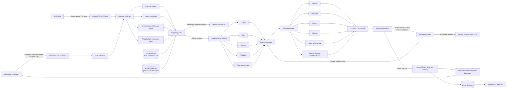
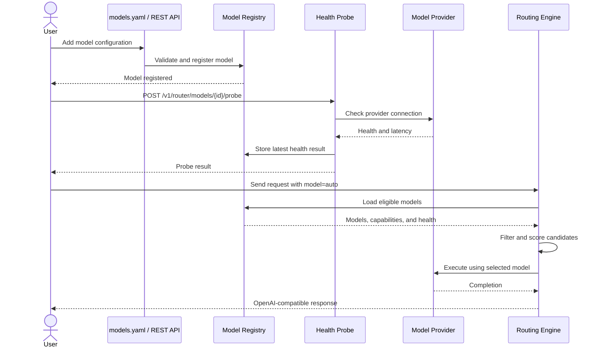

# RouteMCP

RouteMCP is a small, capability-aware gateway for routing OpenAI-compatible chat
requests across multiple model providers. It filters models by hard requirements
(tools, JSON, vision, context, budget, latency, and privacy), ranks the remaining
models, retries another eligible model after provider or validation failures, and
records routing telemetry in SQLite.

RouteMCP also exposes the router as a real Model Context Protocol server. MCP
hosts can inspect routing decisions, execute routed completions, and list model
capabilities through tools served over Streamable HTTP.

## Why not LiteLLM?

LiteLLM is the stronger choice when the main requirement is a mature,
broad-provider proxy with centralized credentials and spend controls. RouteMCP
focuses on a narrower problem: choosing a suitable model for each task or agent
step before making the provider call.

| Concern | General multi-provider proxy | RouteMCP focus |
| --- | --- | --- |
| Provider normalization | Primary feature | Supported, but deliberately small |
| Capability constraints | Usually deployment-level | Hard per-request filters with rejection reasons |
| Task and step routing | Often custom application logic | Deterministic local analyzer and workflow-step routing |
| Tool reliability | General model metadata | Separate tool-call reliability signal |
| Routing transparency | Proxy/load-balancer decision | Candidate components, constraints, and trace explanation |
| MCP | May proxy model APIs | Router itself is exposed as MCP tools |
| Evaluation | Deployment metrics | Strongest, cheapest, and routed policy comparison harness |

This is not evidence that RouteMCP routes better. That claim must come from a
published evaluation on real tasks and models. The repository supplies the
reproducible harness; it intentionally does not publish synthetic headline
numbers as measured results.

## Quick start

RouteMCP requires Python 3.9 or newer.

```bash
python -m venv .venv
source .venv/bin/activate
pip install -e '.[dev]'
cp models.example.yaml models.yaml
routemcp serve --config models.yaml
```

Validate configuration without starting the server with
`routemcp check-config --config models.yaml`.

The example configuration uses mock models and works without API keys. Check the
server and make a routed request:

```bash
curl http://127.0.0.1:8000/healthz

curl http://127.0.0.1:8000/v1/chat/completions \
  -H 'Content-Type: application/json' \
  -d '{
    "model": "auto",
    "messages": [{"role": "user", "content": "Explain consistent hashing"}],
    "route": {"profile": "balanced"}
  }'
```

The response is OpenAI-compatible and includes a `_routemcp` object with the
trace ID, selected configured model, attempt count, and cost estimate.

## Architecture



### Model registration flow



## Configuration

Models are loaded from YAML at startup. Each entry has a RouteMCP `id` and the
provider's own `model` name. Remote providers should reference an environment
variable rather than placing a secret in YAML.

```yaml
models:
  - id: openai-fast
    provider: openai
    model: gpt-4.1-mini
    api_key_env: OPENAI_API_KEY
    cost:
      input_per_million: 0.40
      output_per_million: 1.60
    capabilities:
      tools: true
      json: true
      vision: true
      context_window: 1048576
      max_output_tokens: 32768
```

Supported provider kinds are `openai`, `anthropic`, `gemini`, `ollama`,
`openai-compatible`, and `mock`. Ollama and generic OpenAI-compatible entries
require `base_url`. Native cloud entries require `api_key_env`.

Routing profiles are `cheapest`, `fastest`, `balanced`, and `quality`. Per-request
options can set cost and latency ceilings, require local-only execution, override
task metadata, and cap retry attempts:

```json
{
  "profile": "quality",
  "max_cost_usd": 0.05,
  "max_latency_ms": 5000,
  "privacy": "standard",
  "max_attempts": 3
}
```

## API

- `POST /v1/chat/completions` — route and execute a chat request
- `POST /v1/router/decide` — inspect a decision without calling a model
- `POST /v1/router/workflows` — route and execute an ordered set of agent steps
- `GET /v1/router/models` — list configured models
- `POST /v1/router/models` — register and persist a model
- `PUT /v1/router/models/{id}` — replace a registered model
- `DELETE /v1/router/models/{id}` — remove a registered model
- `POST /v1/router/models/{id}/probe` — probe provider connectivity
- `GET /v1/router/metrics` — aggregate request metrics
- `GET /v1/router/traces/{id}` — inspect a routing trace
- `GET /healthz` — liveness and model count

Set `ROUTEMCP_API_KEY` to require `Authorization: Bearer ...` on `/v1` routes.
Set `ROUTEMCP_DB` to choose the SQLite path. Request prompts are not stored by
default; set `ROUTEMCP_STORE_PROMPTS=true` to retain them in traces.

A model's latest explicit probe result is included in the model list. Provider
failures are also tracked passively; repeated failures open a circuit temporarily
and successful calls reset it. API model changes are persisted in the SQLite
database and survive restarts.

Metrics include request cost, success and escalation rates, model distribution,
latency, and `upper_bound_cost_avoidance_usd`. The latter compares cost with the
most expensive eligible model and is explicitly a diagnostic upper bound—not a
quality-adjusted savings claim. Use the evaluation report for defensible savings.

`stream: true` uses OpenAI-compatible SSE passthrough for OpenAI, Gemini, Ollama,
vLLM, llama.cpp, and generic OpenAI-compatible endpoints. RouteMCP can fail over
when an upstream rejects the request before streaming begins. Once response bytes
have reached the caller, a mid-stream failure cannot safely switch models; it is
recorded and contributes to the circuit breaker. Native Anthropic stream-event
translation is not yet implemented.

## MCP server

The MCP server requires Python 3.11 or newer and the optional dependency:

```bash
pip install -e '.[mcp]'
routemcp mcp --config models.yaml --host 127.0.0.1 --port 8001
```

Connect an MCP client to `http://127.0.0.1:8001/mcp`. It exposes:

- `route_decide` — inspect the selected model, candidate scores, and rejections
- `route_complete` — execute a routed completion with validation and fallback
- `list_routed_models` — inspect registered capabilities, prices, and health

The MCP server uses the current Streamable HTTP transport, not the superseded
standalone SSE transport. The bundled Compose profile binds MCP to localhost;
place an authenticated MCP-aware reverse proxy in front of it before exposing it
on a public network.

With Docker Compose, start both interfaces with:

```bash
docker compose --profile mcp up --build -d
```

## Routing evaluation

Evaluation data is JSONL with explicit deterministic validators. Run the routed
policy against fixed strongest and cheapest baselines:

```bash
routemcp evaluate \
  --config models.yaml \
  --dataset evaluation/tasks.jsonl \
  --strongest-model frontier \
  --cheapest-model local-fast \
  --output evaluation-report.json
```

The report contains task success, cost per success, latency, quality retention
versus the strongest fixed model, and cost reduction versus that same baseline.
The three-row `evaluation/sample.jsonl` only documents the format; it is not a
benchmark and must not be presented as one. A credible published result should
use a reviewed 200–500 task set with held-out task categories.

Supported validators are `exact`, `contains`, `regex`, and `json_fields`.

## Gateway benchmark

Measure the same upstream model directly and through RouteMCP:

```bash
python benchmarks/benchmark_gateway.py \
  --gateway-url http://127.0.0.1:8000/v1/chat/completions \
  --direct-url https://provider.example/v1/chat/completions \
  --gateway-model configured-model-id \
  --direct-model provider-model-id \
  --requests 200 \
  --concurrency 20 \
  --output benchmark-report.json
```

The report includes errors, throughput, p50/p95/p99 latency, and added gateway
latency. Run it near both endpoints and repeat runs before publishing numbers.

The checked-in synthetic localhost smoke run used five alternating rounds of 200
requests at concurrency 20. It recorded zero errors, median throughput of 382.03
requests/second through RouteMCP versus 389.84 direct, and mean added latency of
0.75 ms. Its p50 added latency was 6.75 ms; tail deltas were too noisy to report.
See `benchmarks/results/local-synthetic.json`. This validates the benchmark and
gateway path only—it is not a real-model performance claim or resume result.

### Container end-to-end result

The production image was also exercised through its public HTTP and MCP
interfaces. The local deterministic run completed 1,100 load-test requests with
zero errors. At concurrency 25 it measured 650.48 completion requests/second,
338.34 routing decisions/second, and 357.0 streaming requests/second. Completion
latency was 25.56 ms p50 and 91.03 ms p95.

The same run verified model registration across complete container replacement,
a two-step workflow, stream termination, health probing, three successful typed
failovers, and circuit opening after the third provider failure. Median local
failover latency was 1.50 ms; the first request after the circuit opened took
1.46 ms and skipped the failed provider. A real Streamable HTTP MCP client
negotiated protocol `2026-07-28`, discovered all three tools, and successfully
called `route_decide`.

Full machine-readable results and limitations are in
`benchmarks/results/e2e-container.json`. These are gateway correctness and local
performance numbers—not model-quality evidence.

## Production status

The current release is appropriate for a single-node gateway: durable model
registration, SQLite WAL, API authentication, passive circuit breaking, typed
fallback, streaming passthrough, health probes, Docker, and CI are included.
Horizontal multi-instance deployment still requires PostgreSQL or another shared
registry/telemetry store. Native Anthropic streaming, distributed circuit state,
rate limiting, and automated scheduled probes remain explicit production gaps.

## Development

```bash
pytest
ruff check .
```
